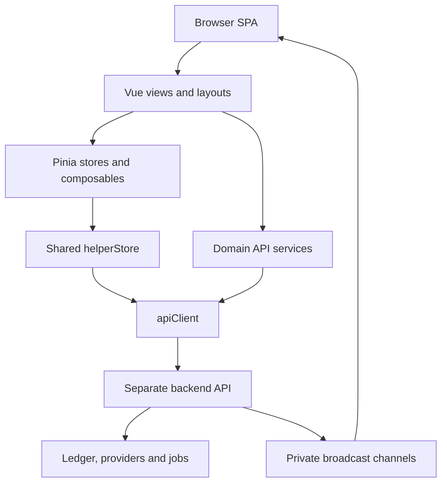

# Xeler Frontend — Developer and Operations Guide

> **Status:** under active development. **License:** proprietary; all rights reserved.  
> **Scope:** the frontend snapshot supplied as `front(20260930-141507).zip`, reviewed on September 30, 2026. The backend is maintained separately and was not supplied for this review.

Xeler is a cryptocurrency and fiat operations web application oriented toward Colombian users. This repository provides the customer interface and administrative backoffice: cryptocurrency purchase and sale workflows, identity verification, payment destinations, an internal XCOP balance interface, operational controls, support chat, reporting, and integration monitoring.

This is a Vue single-page application (SPA). It requests data and actions from a separate HTTP API and receives updates through Pusher-compatible private channels. It does not independently execute blockchain transfers, hold a server-side ledger, send verification messages, or enforce financial authorization. Those responsibilities belong to the backend and its integrations.

**Reading this repository does not establish production readiness.** Screens and API clients demonstrate implemented frontend behavior, not that every external provider is enabled, funded, configured, or operational. This guide records the supplied code; it does not replace the backend route definitions or deployment records.

## Contents

- [Product capabilities](#product-capabilities)
- [Technology and architecture](#technology-and-architecture)
- [Repository map](#repository-map)
- [Local setup](#local-setup)
- [Environment configuration](#environment-configuration)
- [Using the application](#using-the-application)
- [Core workflows and financial contracts](#core-workflows-and-financial-contracts)
- [Authentication and authorization](#authentication-and-authorization)
- [API and realtime integration](#api-and-realtime-integration)
- [Build and deployment](#build-and-deployment)
- [Quality checks](#quality-checks)
- [Known limitations and maintenance priorities](#known-limitations-and-maintenance-priorities)
- [Troubleshooting](#troubleshooting)
- [Development handoff](#development-handoff)
- [Proprietary license](#proprietary-license)
- [Appendix A — Browser routes](#appendix-a--browser-routes)
- [Appendix B — Service request inventory](#appendix-b--service-request-inventory)
- [Appendix C — Generic CRUD resource bindings](#appendix-c--generic-crud-resource-bindings)

## Product capabilities

### Customer application

| Area | Frontend capability | Main implementation |
| --- | --- | --- |
| Public website | Landing sections, pricing/ticker presentation, exchange calculator and navigation | `src/views/HomeView.vue`, `src/views/Home/`, `src/services/tickerApi.ts` |
| Account creation | Multi-step registration with personal, contact, location and referral data | `src/views/auth/Register.vue`, `src/views/auth/Register/`, `src/stores/RegisterStore.ts` |
| Authentication | Login, optional 2FA challenge, logout and password recovery | `src/views/auth/`, `src/services/loginFlow.ts`, `src/stores/TwoFactorAuthStore.ts` |
| Identity | Email and phone verification; timed identity challenges; personal and company KYC interfaces | `src/views/user/Profile/`, `src/views/user/Kyc/`, `src/services/kycApi.ts` |
| Buy cryptocurrency | Backend quote, currency/payment/delivery selection, destination wallet, confirmation, payment instructions and proof upload | `src/views/user/Compra/` |
| Sell cryptocurrency | Crypto selection, fiat/XCOP payout selection, destination account or Bre-B key, quote confirmation and order status | `src/views/user/Venta/` |
| Orders | Transaction history, payment verification pages and unified timeline | `src/stores/TransactionStore.ts`, `src/views/user/Timeline/`, `src/views/user/transactions/` |
| XCOP | Balance summary, movement history, transfers and withdrawal interfaces | `src/stores/XcopStore.ts`, `src/views/user/walletXCOP/` |
| Destinations | User crypto wallets, bank and other payment accounts, favorites, companies and Bre-B keys | `src/views/user/Accounts/`, `src/views/user/wallet/`, `src/views/user/Breb/`, `src/services/brebApi.ts` |
| Referrals | Referral information and referred-user lists | `src/views/user/Refer/` |
| International accounts | Access requests for USD/EUR products, onboarding status, account activation/activity, beneficiaries, external accounts and outbound transfer previews | `src/views/user/InternationalAccounts/`, `src/services/internationalAccountsApi.ts` |
| Support | Floating conversation widget, text and file messages, history, unread updates and sound preference | `src/components/support/SupportChatWidget.vue`, `src/composables/useSupportChatSound.ts` |
| Localization | Spanish default, English fallback and stored language selection | `src/main.ts`, `src/lang/` |

International account visibility is feature/access/permission dependent. Presence of a product in a view does not guarantee eligibility or a live bank account. Bre-B screens manage platform-specific key records and review flows; actual payment execution must be verified in the backend.

### Administrative application

The same SPA provides permission-controlled interfaces for:

- Users, administrators, roles, permissions, penalties, activities and KYC review.
- Order inspection, assignment/take/release/transfer/reassign actions, operational destination changes and payment-proof review.
- Cryptocurrency provider accounts/configuration, connection tests, operational wallets, deposit addresses, transactions, payout creation/retry, reconciliation and health/statistics.
- XCOP withdrawal handling, ledger balance audits, reconciliation records, source-mode status, security preflight and route/float audits.
- Outbox records, webhook delivery/event inspection, gateway status and risk guards.
- Operational control center, per-currency controls, integration settings and emergency controls exposed by the backend.
- Fee rules, exemptions, previews and order adjustments; reports and exports.
- Bre-B key review and platform keys; international access review, account/deposit/transfer administration, service fees and provider synchronization.
- Support inbox with customer search, assignment, claim, reply, close/reopen, proactive messages and customer blocking.
- Reference/configuration CRUD for locations, currencies, networks, payment methods, document types, banks, account types, shipping types, FAQ, company payment accounts and wallets.

Legacy ticket service/view code is still present. The current `/user/support/tickets` route redirects to purchase, and `/admin/support/tickets` redirects to support chat; these paths do not open independent ticket views.

## Technology and architecture

### Dependency snapshot

Use `package-lock.json` as the reproducible installation authority. The versions below are resolved versions in the supplied lockfile, rather than only the ranges in `package.json`.

| Component | Locked version / role |
| --- | --- |
| Node.js | Docker build baseline: `node:22-alpine` |
| npm | Docker explicitly installs `11.11.0` |
| Vue | `3.5.35` |
| TypeScript | `5.9.3` |
| Vue Router | `5.0.7`; HTML5 history |
| Pinia | `3.0.4`; shared domain/session state |
| Vuetify | `4.0.7`; UI components and theme |
| Vite | `8.1.5`; dev server and static bundling |
| Axios | `1.18.1`; HTTP transport |
| Vitest | `4.1.10`; unit/component tests with jsdom |
| Playwright | `1.62.0`; Chromium browser tests |
| Nginx | Docker runtime baseline: `nginx:1.28-alpine` |

Additional packages cover internationalization, charts, QR generation/scanning, telephone validation, crypto address validation, maps, dates, toasts, animations and particles. The package name `flexyvue3ts` and version `0.0.0` are retained in this snapshot; they are not a meaningful product release identifier.

### Runtime structure



`src/main.ts` creates the app and installs Router, Pinia, Vuetify, i18n, charts, particles, typing animation and toasts. It also provides a browser `Buffer` shim. `src/App.vue` renders the active route, global loading overlay, shared 2FA modal and version/build-time indicator.

Views are generally lazy loaded through the router. `FullLayout.vue` contains the authenticated shell, header, sidebars and responsive navigation. Domain services isolate newer API contracts; older resource pages frequently use `helperStore`, a shared CRUD/HTTP/pagination/form helper. Both request paths converge on `apiClient`, except the initial setup/invitation service, which uses Axios directly.

`src/db.ts` is a status-label/configuration map, **not a database connection**. The frontend has no database migration or database server to deploy.

## Repository map

| Path | Purpose and maintenance significance |
| --- | --- |
| `package.json`, `package-lock.json`, `.npmrc` | Commands, dependencies and reproducible install; peer-dependency compatibility setting |
| `index.html`, `public/` | SPA document, favicon and static assets copied to build output |
| `vite.config.ts` | Vue/Vuetify plugins, `@` alias, port 3000, build-time constants |
| `env.d.ts`, `src/shims.d.ts`, `tsconfig*.json` | TypeScript and module declarations |
| `src/main.ts`, `src/App.vue` | Initialization and global UI |
| `src/router/index.ts` | Public/auth routes, layout composition, authenticated navigation |
| `src/router/user.ts`, `src/router/admin.ts`, `src/router/middleware.ts` | Customer/backoffice routes and role/permission/verification guards |
| `src/stores/` | Shared session, catalogs, financial and identity state |
| `src/helper.ts` | HTTP bridge, CRUD, form/loading/toast and pagination helpers |
| `src/services/` | Domain APIs, token/error handling, idempotency and security step-up |
| `src/interfaces/` | DTOs and resource models; inspect these before changing response parsing |
| `src/enums/`, `src/permissions.const.ts` | Domain and permission constants |
| `src/composables/` | Order tracking, 2FA guard, voucher upload and support state/sound |
| `src/utils/`, `src/validator.ts` | Decimal handling, crypto/QR behavior, semantic payment IDs, limits, status and collection parsing |
| `src/views/user/` | Customer operations/profile/KYC/destinations |
| `src/views/admin/` | Backoffice, integrations, reporting, reconciliation and configuration |
| `src/views/support/`, `src/components/support/` | Staff chat and customer support widget |
| `src/components/`, `src/layouts/` | Reusable controls and application shells |
| `src/scss/`, `src/plugins/vuetify.ts` | Theme, global styles, layout styling and fonts |
| `src/lang/es.json`, `src/lang/en.json` | Translation catalogs |
| `src/test/setup.ts`, `src/**/__tests__/`, `src/**/*.spec.ts` | Test setup and colocated unit/component tests; some tests use `.test.ts` |
| `tests/e2e/`, `playwright*.config.ts` | Browser smoke and international account bridge-audit tests |
| `scripts/scan-float-usage.js` | Static report of numeric/decimal usage; not a correctness proof |
| `scripts/validate-production-build-env.mjs` | Production environment and source-diff gate |
| `scripts/write-production-baseline-manifest.mjs` | SHA-256 source baseline generation |
| `FRONTEND_PRODUCTION_BASELINE_MANIFEST.json` | Approved source hash map checked before Docker build |
| `Dockerfile`, `.dockerignore` | Node build and static Nginx runtime |
| `CONTRATO_TECNICO_END_TO_END_XELERGO.pdf`, `HOJA_DE_RUTA_BACKLOG_FRONTEND_XELERGO.pdf` | Historical contract/backlog references; reconcile against current code and backend before treating requirements as current |
| `upgrade-log-2026-03-13.txt` | Historical dependency upgrade notes |

Template/demo components and example images remain, including `src/views/ui-components/` and dashboard sample components. Do not infer a shipped feature solely from an unused component's existence. Router definitions and live imports determine reachability.

## Local setup

### Prerequisites

- Authorized access to this proprietary repository.
- Node.js 22 and preferably the npm version used by the Docker build; keep dependency changes intentional.
- The separate backend running with an API URL accessible by the browser.
- Backend-origin CORS configuration permitting the development origin.
- Public Pusher/Turnstile keys when exercising realtime or challenge-dependent flows.

No backend code or Docker Compose stack is included in this frontend archive. Obtain backend setup, credentials, test users, catalogs and infrastructure instructions from its maintainer.

### Start the frontend

Run from the repository root:

```bash
cp .env.example .env.local
npm ci --legacy-peer-deps --no-audit --no-fund
npm run dev -- --host 127.0.0.1
```

Edit `.env.local` before starting Vite. The template API URL is `http://127.0.0.1:8000/api`. Open `http://127.0.0.1:3000/home`; `/` redirects to `/home`. A busy port may cause Vite to choose another port unless `--strictPort` is passed.

For an isolated development container, use Node 22, mount the source and a dedicated `node_modules` volume, publish port 3000, and start Vite with `--host 0.0.0.0`. Browser API URLs must be reachable from the user's browser: Docker service names are usually unsuitable in `VITE_API_URL`. Do not install frontend dependencies on a production host when an isolated build environment is available.

### Commands

| Command | Actual behavior |
| --- | --- |
| `npm run dev` | Starts Vite, configured port 3000 |
| `npm run typecheck` | Runs `vue-tsc --noEmit` |
| `npm run build` | Vite production-mode bundling only; **does not run typecheck or the production preflight** |
| `npm run build:qa` | Bundles with Vite mode `qa` |
| `npm run build:dev` | Typechecks then bundles with mode `dev` |
| `npm run preview` | Serves an existing `dist/` on port 5050; local verification only |
| `npm test` | Runs Vitest once |
| `npm run test:watch` | Runs interactive/watch Vitest |
| `npm run test:e2e` | Runs default Playwright configuration against an already running URL |
| `npm run lint` | ESLint with `--fix`; may modify source files |
| `node scripts/scan-float-usage.js` | Prints static findings, including decimal-strictness signals |

`.npmrc` contains `legacy-peer-deps=true`, and Docker uses the same install setting. Preserve the lockfile; avoid substituting an unconstrained `npm install` during deployment.

## Environment configuration

All `VITE_*` values become public browser bundle configuration. Never store database credentials, provider private keys, API secrets, Turnstile secrets, Pusher server secrets or private signing material here.

| Variable | Meaning | Default / constraints |
| --- | --- | --- |
| `VITE_API_URL` | Backend API root, including `/api` | Example: `http://127.0.0.1:8000/api`; production preflight requires `https://v2.xeler.io/api` |
| `VITE_PUSHER_APP_KEY` | Public browser app key | Required by realtime constructor and production preflight |
| `VITE_PUSHER_CLUSTER` | Pusher cluster | Required even when a custom WebSocket host is configured |
| `VITE_PUSHER_HOST` | Optional custom WebSocket hostname | If supplied, port must be valid; production preflight requires scheme `https` |
| `VITE_PUSHER_PORT` | Custom WS/WSS port | Integer 1–65535 when custom host is set |
| `VITE_PUSHER_SCHEME` | Custom transport choice | `https` selects WSS; other values select WS in runtime code |
| `VITE_BROADCAST_AUTH_URL` | Private channel authorization endpoint | Runtime default: API root + `/pusher/auth`; runtime restricts the exact endpoint and origin |
| `VITE_API_GOOGLE` | Public Google Maps key | Optional globally; maps require a valid domain/API-restricted key |
| `VITE_TURNSTILE_SITE_KEY` | Public Cloudflare Turnstile key | Required by production preflight; backend must validate challenge responses |
| `VITE_IDENTITY_PHONE_VERIFICATION_REQUIRED` | Phone gate for protected customer operations | Defaults to `true`; only string `false` disables this frontend gate |
| `VITE_ENV_NETWORK` | Crypto address validator environment | Template/Docker default `prod`; `testnet` switches validator network; use testnet only in controlled tests |
| `VITE_ORDER_TRACKING_POLL_INTERVAL_MS` | Order refresh interval | Defaults to `15000`; Docker forwards it; absent from `.env.example` |
| `NODE_OPTIONS` | Node build memory options, not browser configuration | Docker default `--max-old-space-size=3072` |
| `ALLOWED_SOURCE_DIFF` | Comma-separated exact paths exempted from baseline drift checks | Read by preflight only; **not forwarded by the supplied Dockerfile** |

Changing environment values after bundling does not reconfigure deployed JavaScript. Rebuild and redeploy. The Dockerfile accepts Vite values as **build arguments**, while `.dockerignore` excludes `.env` and `.env.*` other than `.env.example`. Passing container runtime `-e VITE_API_URL=...` to Nginx does not rewrite `dist/`.

Vite mode files follow the selected mode: for example `.env.qa` / `.env.qa.local` for `build:qa`. The standalone production preflight reads `process.env`; it does **not** load Vite dotenv files itself. Export validated values through your shell or CI before invoking it.

## Using the application

### Customer workflow

1. Open `/register` and complete registration, or authenticate at `/login`.
2. If login returns `two_factor_required` and `challenge_token`, complete the 2FA challenge before receiving a full session.
3. Open the profile, complete required identity checks/KYC and add appropriate destination wallets/payment accounts. Catalogs are provided by the backend.
4. Open `/user/buy` or `/user/sell`, select the asset and supported payment method, provide the desired amount and destination, and review the backend quote and fees.
5. Confirm the order. If quote values changed, review and confirm again. Submit a payment voucher where the selected flow requires it.
6. Follow the order verification page/timeline until a backend terminal state is reported. Inspect delivery/payout progress separately from payment approval.
7. Use `/wallet-xcop` for XCOP operations and the floating support widget for assistance.

Routes and actions require the user's actual permission and verification state. International products appear only when backend feature/access state and frontend permissions permit them.

### Administrator workflow

1. Authenticate with an authorized staff account. Default navigation is chosen by `UserStore`, not exclusively by a fixed admin URL.
2. Use the dashboard and transaction views to inspect/assign orders; perform only actions granted to the current staff user.
3. Review KYC, account destinations, Bre-B keys, fees and operational configuration through the corresponding panels.
4. Use integration/ledger/security views to investigate provider or reconciliation problems before taking financial actions.
5. Use `/admin/chat-soporte` to process conversations and unread queues.

Initial setup at `/configuracion-inicial` and invitation acceptance at `/aceptar-invitacion/:token` are public frontend entry points to backend-controlled provisioning. They are not authorization bypasses. Confirm that backend bootstrap is closed after setup and that invitations expire according to the backend contract.

## Core workflows and financial contracts

### Quotes and order creation

`src/views/user/Compra/CompraStore.ts` manages shared quote/order state. Important requests include:

- `GET order/flow/payment-methods`, `GET order/flow/shipping-types`, `GET order/flow/fee-options` for backend-supported choices.
- `POST order/flow/quote` for current economic terms.
- `POST order` to create the order from its `quote_id` and destination/payment selections.
- `GET order/my/{tranx_no}` for a customer's order; `GET admin/orders/by-transaction/{tranx_no}` for administrative inspection.

A quote contains backend-calculated decimal-string amounts, rate, provider/network, precision, administrative/network/provider fees, payment semantics, server time and expiry. See `src/interfaces/Order/OrderQuote.model.ts` for exact fields, including gross/net amounts, `requires_voucher`, `instant_payment`, `fee_payment_mode`, `expires_at` and Bre-B metadata.

Order creation intentionally references a quote rather than treating client-side totals as authoritative. The store rejects missing quotes, prevents concurrent creation, handles expired/blocked quotes, and requests user reconfirmation when economic values change. Parallel requests for the same quote input share a pending promise. Preserve these behaviors when refactoring calculators.

Payment method codes (`bank`, `cash`, `other`, `breb`, `xcop`) and semantic ID utilities are preferable to hardcoded database IDs. Exact available methods and delivery routes depend on backend catalogs and operational controls.

### Decimal amounts and limits

`src/utils/decimal.ts` handles decimal strings, validation, comparisons and arithmetic with scaled `BigInt`. It rejects scientific notation in strict inputs and supports Colombian display separators. Multiply/divide helpers have explicit scale/truncation behavior; they are not a general arbitrary-precision financial library.

Use strict decimal normalization at financial payload boundaries. Do not introduce `parseFloat`, binary floating-point arithmetic or formatted display strings into settlement payloads. Some legacy formatting/numeric helpers remain (`src/helper.ts`, `src/validator.ts`, transaction helpers); this snapshot does not establish that all financial calculations are float-free. Review static scan findings in context. Backend precision, rounding, limits and fees remain authoritative.

Operation-limit helpers, quote feedback and penalties control the user experience. Disabling buttons or changing frontend verification flags does not relax backend requirements.

### XCOP

XCOP is presented as an internal COP-related balance, movement and withdrawal facility. The frontend reads `xcop/summary`, `xcop/movements` and `xcop/withdrawals` and submits operations through backend endpoints. Ledger ownership, balance consistency, reserve accounting and settlement are backend responsibilities. Do not describe XCOP as an independently verified on-chain token based on this frontend.

### Crypto addresses and payouts

The local validator maps BTC/LTC/DASH/BCH/ETH to their corresponding networks; USDT and USDC address checks target TRC20 using the TRX validator. This validates address syntax/network selection only. It does not establish provider availability or valid token issuance/support. Review the backend's enabled asset/network/provider contract before changing these mappings.

The backoffice exposes payment-proof approval, payout creation and retry. `cryptoPayoutsApi.ts`, `cryptoPayoutActions.ts` and `cryptoPayoutReconciliation.ts` contain key action/state checks. An approved payment proof and a completed crypto payout are distinct states. Preserve that distinction in labels, timelines and button availability.

Real payout actions can have financial consequences through the backend. Use a controlled test environment to validate them; screenshots or a mocked test do not verify blockchain execution.

### International accounts

The international account service includes customer access/product requests, provider onboarding/sync, USD/EUR accounts and activity, beneficiaries/external accounts, transfer previews/creation, and administrative eligibility, review, fees and reconciliation. It also exposes fake-state/fake-deposit/sandbox-KYC paths for controlled simulations.

These simulation paths must remain controlled by backend environment checks and permissions. Their presence in browser code does not mean they should work in production. Provider identity, actual rail support, settlement timing and funds availability require backend/provider documentation.

### Support and uploads

Customer/staff chat handles conversation references, cursor-paginated messages, message UUIDs, attachments, unread counters and administrative assignments. Standard message sending builds `FormData` with `client_message_id`, optional `body` and `attachments[]`. Downloads use authenticated backend blob requests.

The proactive `initiateChat` helper currently submits a plain object with an attachments array; confirm multipart behavior with the backend before assuming proactive file uploads work exactly like regular replies. UI attachment acceptance is not sufficient file security: backend validation, ownership and download authorization are required.

KYC uses draft saving, document upload, submission, status transitions and protected downloads. Voucher uploads use `useVoucherUpload`; keep payload encoding and backend field names intact.

## Authentication and authorization

### Session lifecycle

- `authToken.ts` stores bearer tokens in `sessionStorage`, with optional expiry metadata, and removes legacy token copies from `localStorage`.
- Expiry may come from stored metadata or a decoded JWT `exp`. Decoding is used for local expiry checks; it does not verify a JWT signature.
- `UserStore` persists session user state, manages permissions/navigation context and clears session-related data on logout.
- `apiErrors.ts` normalizes transport/validation errors; 401 and 423 clear authentication and redirect to login, except while explicit logout is in progress.
- No autonomous refresh-token mechanism is established by these helpers. Inspect the backend before adding one.

Session storage is readable by same-origin JavaScript, so XSS prevention still matters. Do not log bearer tokens, challenge values, setup tokens or provider credentials.

### Route and action guards

`router/index.ts` blocks non-public routes without a token. Middleware checks allowed roles, all/any permissions, role-or-permission combinations, and required verification flags. Dot-delimited permission names and legacy CRUD references both exist. `UserStore`, `permissionActions.ts`, permission enums and sidebar/menu definitions must remain consistent.

Client-side checks control navigation and visibility. The backend must independently enforce permission, ownership, account restrictions, KYC, 2FA, limits and financial state on every request.

### Financial step-up and idempotency

`TwoFactorAuthStore` can request `POST security/step-up`. Scope-specific grants are stored in memory and consumed once when attached as `X-Financial-Step-Up` to an official API request. Scopes include XCOP, crypto payout, financial destinations/configuration, order administration, international accounts and admin security.

`apiClient` adds `X-Request-Id` and an `Idempotency-Key` for opted-in mutating/financial requests. `idempotency.ts` reuses a key for a matching operation scope/payload and clears it after successful completion in callers. This state is in memory: it does not survive a page reload. Backend idempotency storage and conflict handling are required; headers alone do not ensure exactly-once execution.

## API and realtime integration

### HTTP destination and envelope rules

`apiClient.ts` resolves requests against `VITE_API_URL`. Bearer authorization and financial step-up grants attach only when the resolved destination matches the configured official origin and API path prefix. Ambiguous double-slash prefixes are rejected for authorization matching. The public HTTP helper strips explicit Authorization headers.

Responses coexist in several shapes:

```json
{"response": {"id": 123, "attributes": {}}}
```

```json
{"data": [{"id": 123, "attributes": {}}], "meta": {"current_page": 1, "last_page": 1}}
```

`apiClient.normalize` prioritizes `response`, then `data`, then the raw body. Not all consumers call this helper; some expect a specific envelope. `helperStore` has legacy pagination parsing, while newer modules and `responseCollection` utilities normalize particular collection contracts. Keep resource IDs, nested attributes, list metadata and scalar/null handling compatible with the actual consumer.

Expected error behavior includes 401 (expired session), 403 (permission denial), 409 (state conflict), 422 (validation), 423 (restriction/session closure) and 429 (`Retry-After`). Quote-specific error codes drive retry/reconfirmation behavior. Do not translate all failures into a generic successful/empty response.

For cross-origin use, backend CORS must allow the frontend origin, methods and headers, including Authorization, Content-Type, X-Request-Id, Idempotency-Key and X-Financial-Step-Up. Setup uses `withCredentials: true`, so its cookie/CORS behavior differs from ordinary bearer requests. Configure it deliberately with the backend.

### Realtime contracts

| Use | Channel | Event |
| --- | --- | --- |
| Order updates | `private-orders.{orderId}` | `.order.status.changed` |
| User notifications | `private-notification.{userId}` | `App\Events\NotificateEvent` |
| Customer support | `private-support.user.{userId}` | `.support.chat.updated` |
| Staff support | `private-support.staff` | `.support.chat.updated` |

Private channel authorization is restricted at runtime to the configured API's exact `/pusher/auth` path. The production preflight's broadcast URL validation is broader (same official origin and `/api/` prefix), so a URL may pass preflight but still be rejected by the runtime Pusher resolver.

Order tracking refreshes authoritative HTTP state after events and also polls every 15 seconds by default. It pauses on hidden tabs, resumes when visible, skips overlapping requests and stops on `is_terminal`. Subscriptions/listeners are removed on unmount. The `isRealtimeConnected` flag is set after constructing the subscription; it is not an independently verified WebSocket connection-health measurement.

Staff support summary also resynchronizes on visibility/focus and polls at 60 seconds. Inspect individual widget/inbox logic when altering reconnect behavior; do not assume all modules share order tracking's fallback behavior.

### Separate backend integration checklist

Before treating this frontend as fully integrated, confirm the backend's actual routes and contracts for authentication, verification/OTP, Turnstile validation, KYC documents, catalogs, quotes/orders/proofs, XCOP, payouts, financial step-up, idempotency, permissions, broadcasts, support attachments, operational reporting and international products. Obtain a backend API specification when available.

The request inventory below describes frontend consumers, **not an OpenAPI specification or proof that those routes exist server-side**. Backend deployment commands, PHP/framework/database versions, migrations, queue workers and provider secrets cannot be established from this frontend alone.

## Build and deployment

### Static build

For local/QA verification:

```bash
npm ci --legacy-peer-deps --no-audit --no-fund
npm run typecheck
npm test
npm run build:qa
npm run preview -- --host 127.0.0.1
```

The output is `dist/`. Production release validation should also run the environment/source preflight with exported production values, then `npm run typecheck` and `npm run build`. Vite preview is not the intended production server.

Serve this SPA at the domain root. Router history is hardcoded to `/`, and Vite has no alternate base configured. Subdirectory hosting requires coordinated changes to router history, Vite base, asset URLs and reverse-proxy routing.

### Supplied Docker design and current blockers

The Dockerfile has two stages:

1. Node 22 installs npm 11.11.0, installs the exact lockfile, copies source, runs production preflight, typecheck and build.
2. Nginx 1.28 serves `dist/`, exposes port 8080 and checks `/healthz` every 30 seconds.

**The supplied archive is not a complete working Docker deployment context as-is:**

- `COPY default-nginx.conf /etc/nginx/conf.d/default.conf` references a file absent from the archive.
- The source baseline differs in five files, listed in Known limitations.
- `.dockerignore` excludes `src/**/*.spec.ts` and `src/**/__tests__`, but the baseline generator tracks all files under `src/`, including tests. Missing tracked test files inside the Docker context can therefore produce additional source-diff failures.
- `ALLOWED_SOURCE_DIFF` is not declared/forwarded by Docker, so setting that variable on the host does not automatically reach its preflight step.

Restore the intended Nginx configuration from the authoritative repository if available. Reconcile baseline scope and Docker context as a reviewed code change. Do not regenerate the baseline just to silence unreviewed drift.

### Example missing Nginx configuration

The following is a **suggested minimal configuration**, not a recovered project file. Save as `default-nginx.conf` at the repository root if the maintainer approves it. This example serves static content only; an external HTTPS reverse proxy must route `/api/` to the actual backend when sharing a domain.

```nginx
server {
    listen 8080;
    server_name _;
    root /usr/share/nginx/html;
    index index.html;

    location = /healthz {
        access_log off;
        default_type text/plain;
        return 200 'ok';
    }

    location = /index.html {
        add_header Cache-Control 'no-cache' always;
    }

    location /assets/ {
        try_files $uri =404;
        expires 1y;
        add_header Cache-Control 'public, immutable';
    }

    location /api/ {
        return 404;
    }

    location / {
        try_files $uri $uri/ /index.html;
    }
}
```

The `/api/` 404 prevents accidental HTML responses from the static server; it is **not backend routing**. Route API traffic at the outer proxy or replace this block with an explicitly configured backend proxy. The health endpoint confirms static server availability only, not API/provider/ledger health.

### Production build after resolving blockers

Export the production variables listed in Environment configuration through your deployment environment. The existing preflight accepts only the official API destination; deployment to another domain requires an intentional reviewed policy change.

```bash
docker build \
  --build-arg VITE_API_URL \
  --build-arg VITE_PUSHER_APP_KEY \
  --build-arg VITE_PUSHER_CLUSTER \
  --build-arg VITE_PUSHER_HOST \
  --build-arg VITE_PUSHER_PORT \
  --build-arg VITE_PUSHER_SCHEME \
  --build-arg VITE_BROADCAST_AUTH_URL \
  --build-arg VITE_API_GOOGLE \
  --build-arg VITE_TURNSTILE_SITE_KEY \
  --build-arg VITE_ENV_NETWORK=prod \
  --build-arg VITE_IDENTITY_PHONE_VERIFICATION_REQUIRED=true \
  --build-arg VITE_ORDER_TRACKING_POLL_INTERVAL_MS=15000 \
  -t xeler-frontend:reviewed .

docker run -d \
  --name xeler-frontend \
  --restart unless-stopped \
  -p 127.0.0.1:8080:8080 \
  xeler-frontend:reviewed
```

Use an HTTPS reverse proxy/CDN with the correct domain and API routing. Forward websocket connections as required by the chosen broadcast infrastructure. Restrict public browser keys to approved domains/APIs. These commands describe a deployment procedure; no production deployment was performed during this documentation review.

### Baseline discipline, releases and rollback

The production preflight requires API/Pusher/Turnstile public settings, rejects placeholder/local production values and verifies SHA-256 source hashes. Tracked scope is `src/`, `scripts/`, Dockerfile, package files and Vite config. Several deployment-relevant files, including Nginx config, public assets and `.dockerignore`, are outside this hash scope.

After reviewing an approved change and making Docker context/baseline scope consistent, regenerate the baseline deliberately:

```bash
node scripts/write-production-baseline-manifest.mjs
```

Commit the approved source and manifest together. The writer can include excluded-test omissions if run in a reduced context; never treat a context-generated baseline as equivalent to a reviewed full-repository baseline.

Tag releases by commit/release identifier, retain the previous immutable image/artifact and matching public build configuration, and record backend compatibility. To roll back, restore the previous image/artifact and verify route reload, login, API compatibility and status reads. Backend state/schema compatibility must be confirmed independently; frontend rollback does not undo payments or backend changes.

After deployment verify `/healthz`, a direct refresh of nested routes, expected build indicator, login/permission denial, quote rendering, supported methods, private-channel auth, polling, protected downloads and support unread state. Exercise financial mutations only within explicitly authorized controlled validation.

## Quality checks

### Unit and component tests

Vitest merges the Vite configuration, runs in jsdom, loads `src/test/setup.ts`, clears mocks and excludes browser tests. Existing tests cover token/destination security, login/identity flows, Pusher authorization, idempotent payout behavior, collection parsing, decimal inputs, semantic IDs, limits, quotes/buy/sell flows, upload guards, KYC, support chat, international accounts, reports and store safety.

Run the full suite with `npm test`, or target a relevant existing spec:

```bash
npx vitest run src/services/__tests__/apiClientSecurity.spec.ts
npx vitest run src/composables/__tests__/useOrderTracking.spec.ts
```

Typecheck separately. `npm run build` succeeding is not evidence that types/tests pass. To inspect lint without automatic fixes, invoke ESLint without `--fix` using the extensions in the package script; the provided lint command mutates files.

### Browser tests

Default Playwright does not start a web server. Start the correct frontend and backend first. It uses `E2E_BASE_URL` or `http://127.0.0.1:8084` and optional `E2E_ADMIN_EMAIL`, `E2E_ADMIN_PASSWORD`, `E2E_USER_EMAIL`, `E2E_USER_PASSWORD`. Credential-dependent tests skip when those variables are absent.

```bash
npx playwright install chromium
E2E_BASE_URL=http://127.0.0.1:8084 npm run test:e2e
```

Use controlled QA accounts. Runtime tests check admin central screens, user denial of an admin route and login usability at 360×800, 390×844, 768×1024, 1366×768 and 1920×1080. Account state/2FA/Turnstile must match test expectations.

The dedicated bridge audit serves an already built `dist/` at port 18193:

```bash
npm run build:qa
npx playwright test --config playwright.bridge-audit.config.ts
```

Bridge audit fixtures mock API behavior; they validate browser rendering/contracts under those fixtures, not a live financial provider. The default configuration discovers both browser spec files; the bridge configuration selects only `bridge-audit.spec.ts`. Reports/traces/screenshots are configured under test output paths.

### Review validation boundary

This document was produced through static source/configuration/lockfile analysis and a SHA-256 comparison with the included baseline. Dependencies were not installed, and typecheck, unit tests, browser tests and Docker build were not executed during this review. No backend, cloud provider, bank rail or blockchain transaction was validated. Existing tests are documented as available checks, not reported as passing.

## Known limitations and maintenance priorities

1. **Missing Nginx file:** recover or supply `default-nginx.conf` before the Docker runtime stage can be built.
2. **Baseline drift:** five supplied files differ from their manifest hashes:
   - `src/components/support/SupportChatWidget.vue`
   - `src/layouts/full/header/MessagesComponent.vue`
   - `src/services/supportChatApi.ts`
   - `src/test/setup.ts`
   - `src/views/support/SupportChatAdminView.vue`
3. **Docker context versus baseline:** test exclusions can cause the preflight to see deleted tracked files. Review both policies together.
4. **Production portability:** the preflight intentionally pins `https://v2.xeler.io/api`; another domain is not accepted without changing that policy.
5. **No standalone backend setup:** this archive cannot establish server-side routes, provider status, permissions, queues or settlement guarantees.
6. **Mixed response conventions:** legacy `response` envelopes coexist with `data` resources; protect contracts when refactoring shared helpers.
7. **Legacy financial formatting:** float-based helpers remain alongside stricter decimal utilities. Scan and test affected money paths before relying on them.
8. **Proactive support attachments:** object-based initiation differs from standard multipart chat sending; verify with the backend.
9. **Frontend integration status is limited:** some connection flags describe subscription creation rather than transport confirmation; mock tests do not prove provider connectivity.
10. **Release/ownership metadata:** package version is `0.0.0`; no standalone `LICENSE` was supplied. Adopt meaningful releases and add an owner-approved proprietary `LICENSE` file.
11. **Route compatibility:** historical spellings such as `bussiness`, `ubications`, `departaments` and API `countrys` are part of existing contracts. Renaming them requires redirect/API compatibility planning.

These are findings and follow-up items from the snapshot, not fixes applied to the source. The frontend archive was left unchanged.

## Troubleshooting

| Symptom | Likely checks |
| --- | --- |
| API unavailable / CORS message | Backend reachable from browser, exact API root, HTTPS/mixed content, allowed origin/headers, backend logs |
| Nested route reload returns 404 | Configure SPA history fallback; ensure `/api/` is routed to backend rather than `index.html` |
| Changing container env has no effect | Vite settings are compiled; rebuild with correct build arguments |
| Production preflight fails | Required exported variables, official API domain/path, placeholder markers, baseline drift and omitted Docker-context files |
| Docker COPY fails | Missing `default-nginx.conf` |
| Realtime unavailable | Public key/cluster, WSS host/port/TLS, exact official `/api/pusher/auth`, token and backend channel permissions |
| Login works but protected operation redirects | Permission set and email/phone/KYC flags; inspect `checkedVerificationsUser` |
| Unexpected login redirect | Token expiry, backend 401/423, session storage and account restrictions |
| Empty/malformed tables | `response` versus `data` envelope, array/resource shape, pagination fields and current consumer expectations |
| Quote confirmation rejected | Quote expiry, updated values/reconfirmation, limits/penalties, backend operational controls |
| Duplicate/retried financial request | Operation key reuse/clear timing, page reload behavior and backend idempotency response |
| International menu missing | Backend feature flag/access status, navigation context and view permission |
| Test report shows skipped logins | QA credential variables absent; skips do not establish authenticated coverage |
| Turnstile never completes | Site key/domain restrictions, script access, challenge lifecycle and backend validation |
| Maps missing | Google public key restrictions/API enablement and network access |
| Sound or clipboard/camera unavailable | Browser permissions/user gesture, HTTPS secure context and supported browser APIs |

## Development handoff

### Finding the right implementation

| Change | Read first | Also check |
| --- | --- | --- |
| Quote/fee/payment method bug | `CompraStore.ts`, quote model, buy/sell calculators | Semantic payment utilities, fee breakdown tests, backend quote contract |
| Order status/delivery problem | `TransactionStore.ts`, `useOrderTracking.ts`, timeline/status helpers | Payout action/reconciliation helpers and event payloads |
| Token/permission/navigation bug | `UserStore.ts`, token/error services, router middleware | Sidebar/header menus, permission constants and backend grants |
| Bank/wallet/Bre-B destination | Account views, wallet/account stores, `brebApi.ts` | Ownership, favorites, masked identifiers and step-up scope |
| KYC/OTP issue | KYC API/views, identity challenge store, email/phone views | Challenge expiration/resend tests and protected downloads |
| Provider configuration | Crypto provider services/models/views | Connection tests, masked secrets and backend configuration policy |
| Support regression | Widget, staff view, chat service, global/sound composables | UUIDs, pagination, attachments, unread counters and cleanup |
| International feature | International service/models, customer/admin panels | Feature/access gating, fake-versus-live state and bridge audit |
| Deployment failure | Dockerfile, `.dockerignore`, preflight and manifest | Missing Nginx config, build arguments and reverse-proxy routing |

### Implementing an authorized change

1. Locate the route/view, its store/service and resource model. Confirm the backend contract before altering field names or request methods.
2. Keep financial decisions on the backend. Reuse shared decimal, request, permission, upload and step-up helpers.
3. Update translations and permission-controlled navigation/actions where needed. Avoid exposing private credentials through Vite or logs.
4. Run focused existing tests, typecheck and the appropriate build; run browser tests for affected user journeys with suitable fixtures/QA accounts.
5. Review source diffs and production baseline/context compatibility. Record the backend/API dependency and rollout/rollback requirements.
6. Update this guide when a route, contract, environment variable or deployment process changes.

### What to add when the backend is available

Link the backend repository and authoritative API specification; document confirmed backend setup and deployment, schema/seed requirements, roles/permissions, quote/order state machines, provider/network availability, event contracts, OTP delivery, queue/outbox workers, file storage, idempotency semantics and financial reconciliation. Do not fill those gaps with assumptions from frontend naming.

## Proprietary license

**Proprietary software — all rights reserved.**

This repository, its application source, project-specific documentation and original assets are proprietary. No open-source license is granted. Access to this repository, including any public visibility on GitHub, does not by itself grant permission to use, copy, modify, redistribute, sublicense, sell or deploy the project. Any such permission must be granted explicitly in writing by the applicable rights holder, except where required by applicable law or an existing valid agreement.

Authorized developers may work on the project only within the scope of their agreement with the rights holder. Third-party dependencies and third-party assets remain subject to their respective licenses; this notice does not override those licenses or claim ownership of them.

The supplied archive did not identify a definitive legal rights-holder name or contain a standalone license file. The owner should add the correct legal attribution and a matching proprietary `LICENSE` file before relying on repository metadata as a complete licensing record. Do not infer the rights holder from the uploader, branding or historical template package name.

---

## Appendix A — Browser routes

This inventory preserves route literals from the supplied router files. Child profile paths are relative to `/user/profile`; `user/menu-mobile` resolves under the root layout. Guards and redirects remain authoritative in the linked source files.

### `src/router/index.ts`

| Route path | Route name |
| --- | --- |
| `/home` | `Home` |
| `/auth` | `(layout / redirect / fallback)` |
| `/login` | `Login` |
| `/register` | `Register` |
| `/recover-password` | `recover-password` |
| `/unauthorized` | `Unauthorized` |
| `/forbidden` | `Forbidden` |
| `/configuracion-inicial` | `InitialSetup` |
| `/aceptar-invitacion/:token` | `AcceptAdminInvitation` |
| `/` | `(layout / redirect / fallback)` |
| `notifications/2` | `Notifications` |
| `/404` | `NotFound` |
| `/:pathMatch(.*)*` | `(layout / redirect / fallback)` |

### `src/router/user.ts`

| Route path | Route name |
| --- | --- |
| `/user/international-accounts` | `user-international-accounts` |
| `/user/support/tickets` | `user-support-tickets` |
| `/user/timeline/:numTransaction` | `user-timeline` |
| `/user/check-buy/:numTransaction` | `user-check-buy` |
| `/user/check-sell/:numTransaction` | `user-check-sell` |
| `/user/buy` | `user-buy` |
| `/user/sell` | `user-sell` |
| `/user/transactions` | `user-transactions` |
| `/user/referred` | `user-referred` |
| `/user/referred-list` | `user-referred-list` |
| `/wallet-xcop` | `wallet-xcop` |
| `user/menu-mobile` | `user-mobile-view` |
| `/user/profile` | `user-profile` |
| `personal-data` | `user-personal-data` |
| `wallets` | `user-wallets` |
| `bank-accounts` | `user-bank-accounts` |
| `other-accounts` | `user-other-accounts` |
| `referreds` | `user-referreds` |
| `password` | `user-password` |
| `companies` | `user-companies` |
| `breb-keys` | `user-breb-keys` |
| `kyc` | `user-kyc` |
| `/user/bussiness` | `bussiness` |

### `src/router/admin.ts`

| Route path | Route name |
| --- | --- |
| `/admin/administradores` | `admin-administrators` |
| `/admin/international-accounts` | `admin-international-accounts` |
| `/admin/breb` | `admin-breb` |
| `/admin/fees` | `admin-fees` |
| `/admin/chat-soporte` | `admin-support-chat` |
| `/admin/support/tickets` | `admin-support-tickets` |
| `/admin/reports` | `admin-reports` |
| `/kyc` | `admin-kyc` |
| `/kyc-bussiness` | `admin-kyc-bussiness` |
| `/withdrawal-xcop` | `admin-withdrawal-xcop` |
| `/users` | `admin-users` |
| `/dashboard` | `Dashboard` |
| `/admin/transactions` | `admin-transactions` |
| `/admin/control-center` | `admin-control-center` |
| `/admin/outbox` | `admin-outbox` |
| `/admin/outbox/:id` | `admin-outbox-show` |
| `/admin/ledger/reconciliations` | `admin-ledger-reconciliations` |
| `/admin/ledger/reconciliations/:id` | `admin-ledger-reconciliation-show` |
| `/admin/operability/readiness` | `admin-operability-readiness` |
| `/admin/security/route-audit` | `admin-security-route-audit` |
| `/admin/ledger/audit-balances` | `admin-ledger-audit-balances` |
| `/admin/audit/logs` | `admin-audit-logs` |
| `/admin/audit/logs/:id` | `admin-audit-log-show` |
| `/admin/integrations/webhooks` | `admin-webhook-events` |
| `/admin/integrations/webhooks/:id` | `admin-webhook-event-show` |
| `/admin/integrations/gateways` | `admin-gateway-status` |
| `/admin/integrations/crypto/operational-wallets` | `admin-operational-wallets` |
| `/admin/integrations/crypto/providers` | `admin-crypto-providers` |
| `/admin/integrations/crypto/addresses` | `admin-crypto-addresses` |
| `/admin/integrations/crypto/addresses/:id` | `admin-crypto-address-show` |
| `/admin/integrations/crypto/transactions` | `admin-crypto-transactions` |
| `/admin/integrations/crypto/transactions/:id` | `admin-crypto-transaction-show` |
| `/admin/integrations/crypto/health` | `admin-crypto-health` |
| `/admin/risk/guards` | `admin-risk-guards` |
| `/admin/transactions/:numTransaction` | `admin-transaction-show` |
| `/configurations/security/roles` | `admin-configurations-security-roles` |
| `/configurations/ubications/countries` | `admin-configurations-ubications-countries` |
| `/configurations/ubications/departaments` | `admin-configurations-ubications-departaments` |
| `/configurations/ubications/municipalities` | `admin-configurations-ubications-municipalities` |
| `/configurations/generals` | `admin-configurations-generals` |
| `/configurations/generals/type-documents` | `admin-configurations-type-documents` |
| `/configurations/generals/banks` | `admin-configurations-generals-banks` |
| `/configurations/generals/platforms` | `admin-configurations-generals-platforms` |
| `/configurations/generals/currencies` | `admin-configurations-generals-currencies` |
| `/configurations/generals/type-currencies` | `admin-configurations-generals-type-currencies` |
| `/configurations/generals/payment-methods` | `admin-configurations-generals-payment-methods` |
| `/configurations/generals/other-payments` | `admin-configurations-generals-other-payments` |
| `/configurations/generals/type-accounts` | `admin-configurations-generals-type-accounts` |
| `/configurations/generals/shipping-types` | `admin-configurations-generals-shipping-types` |
| `/configurations/generals/penalty-type` | `admin-configurations-generals-penalty-type` |
| `/configurations/generals/network-types` | `admin-configurations-generals-network-types` |
| `/configurations/banks-accounts` | `admin-configurations-banks-accounts` |
| `/configurations/efecty-accounts` | `admin-configurations-efecty-accounts` |
| `/configurations/other-accounts` | `admin-configurations-other-accounts` |
| `/configurations/external-deposits` | `admin-configurations-external-deposits` |
| `/configurations/wallets` | `admin-configurations-wallets` |
| `/configurations` | `admin-configurations` |
| `/admin/profile` | `admin-profile` |
| `/activities` | `activities` |

## Appendix B — Service request inventory

Methods and URL expressions below are extracted from explicit domain-service request calls. Paths are relative to `VITE_API_URL` unless the service constructs an absolute URL. `${...}` denotes runtime interpolation; action unions, parameters, payloads, security options and response types are defined in the referenced service. Dynamic helper calls and URL variables may require reading the source. This inventory does not assert that the separate backend implements every request.

### `src/services/adminAuditApi.ts`

| Method | Endpoint expression |
| --- | --- |
| GET | `admin/audit-logs` |
| GET | `admin/audit-logs/${id}` |

### `src/services/adminReportsApi.ts`

| Method | Endpoint expression |
| --- | --- |
| GET | `admin/reports/operations` |

### `src/services/adminSetupApi.ts`

| Method | Endpoint expression |
| --- | --- |
| GET | `${base}/setup/status` |
| POST | `${base}/setup/token/exchange` |
| POST | `${base}/setup/superadmin` |
| GET | `${base}/admin-invitations/${encodeURIComponent(token)}` |
| POST | `${base}/admin-invitations/${encodeURIComponent(token)}/accept` |

### `src/services/apiClient.ts`

| Method | Endpoint expression |
| --- | --- |
| GET | `normalizedUrl` |

### `src/services/brebApi.ts`

| Method | Endpoint expression |
| --- | --- |
| GET | `breb/keys` |
| POST | `breb/keys` |
| PUT | `breb/keys/${id}` |
| POST | `breb/keys/${id}/submit` |
| POST | `breb/keys/${id}/disable` |
| DELETE | `breb/keys/${id}` |
| POST | `breb/keys/${id}/${active ? "set" : "clear"}-favorite` |
| GET | `admin/breb/keys/pending` |
| GET | `admin/breb/keys/${id}` |
| POST | `admin/breb/keys/${id}/review` |
| GET | `admin/breb/platform-keys` |
| POST | `admin/breb/platform-keys` |
| PUT | `admin/breb/platform-keys/${id}` |
| POST | `client/wallet/${id}/${active ? "set" : "clear"}-favorite` |
| POST | `client/account/${id}/${active ? "set" : "clear"}-favorite` |

### `src/services/companiesApi.ts`

| Method | Endpoint expression |
| --- | --- |
| GET | `companys` |
| GET | `companys/approved` |
| GET | `companys/${id}` |
| POST | `companys/${id}/beneficial-owners` |
| PUT | `companys/${id}/beneficial-owners/${ownerId}` |
| DELETE | `companys/${id}/beneficial-owners/${ownerId}` |
| POST | `companys/${id}/documents` |
| POST | `companys/${id}/submit` |
| GET | `companys/kyc` |
| GET | `companys/kyc/${id}` |
| PUT | `companys/kyc/${id}/transition` |

### `src/services/controlCenterApi.ts`

| Method | Endpoint expression |
| --- | --- |
| GET | `admin/control-center/status` |
| PATCH | `admin/control-center/system` |
| GET | `admin/control-center/currencies` |
| PATCH | `admin/control-center/international-accounts` |
| PATCH | `admin/control-center/currencies/${id}` |
| POST | `admin/control-center/manual-mode` |
| POST | `admin/control-center/emergency/activate` |
| POST | `admin/control-center/emergency/request-unlock` |
| POST | `admin/control-center/emergency/confirm-unlock` |
| POST | `admin/control-center/crypto-providers/sync-from-config` |
| GET | `operations/status` |

### `src/services/cryptoAddressesApi.ts`

| Method | Endpoint expression |
| --- | --- |
| GET | `admin/crypto/addresses` |
| GET | `admin/crypto/addresses/${id}` |

### `src/services/cryptoHealthApi.ts`

| Method | Endpoint expression |
| --- | --- |
| GET | `admin/crypto/providers-health` |
| GET | `admin/crypto/stats` |

### `src/services/cryptoPayoutsApi.ts`

| Method | Endpoint expression |
| --- | --- |
| POST | `admin/crypto/payouts` |
| POST | `admin/crypto/orders/${orderId}/payment-proof/approve` |
| POST | `admin/crypto/orders/${orderId}/payout/retry` |

### `src/services/cryptoProvidersApi.ts`

| Method | Endpoint expression |
| --- | --- |
| GET | `admin/crypto/providers` |
| GET | `admin/crypto/providers/accounts` |
| GET | `admin/crypto/providers/accounts/${provider}` |
| PATCH | `admin/crypto/providers/accounts/${provider}` |
| GET | `admin/crypto/providers/${id}` |
| POST | `admin/crypto/providers` |
| PATCH | `admin/crypto/providers/${id}` |
| POST | `admin/crypto/providers/${id}/test-connection` |

### `src/services/cryptoTransactionsApi.ts`

| Method | Endpoint expression |
| --- | --- |
| GET | `admin/crypto/transactions` |
| GET | `admin/crypto/transactions/${id}` |
| POST | `admin/crypto/transactions/${id}/resolve` |
| POST | `admin/crypto/transactions/${id}/resolve-reconciliation` |

### `src/services/feesApi.ts`

| Method | Endpoint expression |
| --- | --- |
| GET | `admin/fees` |
| POST | `admin/fees` |
| PUT | `admin/fees/${id}` |
| POST | `admin/fees/${id}/toggle` |
| GET | `admin/fees/exemptions/list` |
| GET | `admin/fees/catalog/users` |
| GET | `admin/fees/catalog/companies` |
| POST | `admin/fees/exemptions` |
| PUT | `admin/fees/exemptions/${id}` |
| POST | `admin/fees/exemptions/${id}/toggle` |
| POST | `admin/fees/preview` |
| POST | `admin/fees/orders/${orderId}/adjustments` |

### `src/services/gatewaysApi.ts`

| Method | Endpoint expression |
| --- | --- |
| GET | `admin/gateways/status` |
| GET | `admin/gateways/status/${provider}` |

### `src/services/integrationSettingsApi.ts`

| Method | Endpoint expression |
| --- | --- |
| GET | `admin/control-center/integrations` |
| GET | `admin/control-center/integrations/${group}` |
| PATCH | `admin/control-center/integrations/${group}` |
| POST | `admin/control-center/integrations/${group}/test` |

### `src/services/internationalAccountsApi.ts`

| Method | Endpoint expression |
| --- | --- |
| GET | `international-accounts/access` |
| POST | `international-accounts/access/request` |
| POST | `international-accounts/access/products` |
| GET | `international-accounts/onboarding` |
| POST | `international-accounts/onboarding/start` |
| POST | `international-accounts/onboarding/sync` |
| GET | `admin/international-accounts` |
| POST | `admin/international-accounts/users/${userId}/eligibility` |
| GET | `admin/international-accounts/users/candidates` |
| POST | `admin/international-accounts/${accessId}/${action}` |
| GET | `admin/international-accounts/${accessId}/provider` |
| POST | `admin/international-accounts/${accessId}/provider/sync` |
| POST | `admin/international-accounts/${accessId}/provider/fake-state` |
| POST | `admin/international-accounts/${accessId}/provider/sandbox-kyc-approval` |
| GET | `international-accounts/accounts` |
| POST | `international-accounts/accounts/${product}/activate` |
| GET | `international-accounts/accounts/${accountId}` |
| GET | `international-accounts/accounts/${accountId}/activity` |
| GET | `admin/international-accounts/accounts` |
| POST | `admin/international-accounts/accounts/${accountId}/sync` |
| POST | `admin/international-accounts/accounts/${accountId}/${action}` |
| GET | `admin/international-accounts/deposits` |
| POST | `admin/international-accounts/accounts/${accountId}/fake-deposit` |
| POST | `admin/international-accounts/deposits/${depositId}/fake-state` |
| POST | `admin/international-accounts/wallets/${walletId}/reconcile` |
| GET | `international-accounts/beneficiaries` |
| POST | `international-accounts/beneficiaries` |
| POST | `international-accounts/beneficiaries/${beneficiaryId}/external-accounts` |
| GET | `international-accounts/external-accounts` |
| POST | `international-accounts/transfers/preview` |
| POST | `international-accounts/transfers` |
| GET | `international-accounts/transfers` |
| GET | `international-accounts/transfers/${transferId}` |
| GET | `admin/international-accounts/beneficiaries` |
| GET | `admin/international-accounts/external-accounts` |
| POST | `admin/international-accounts/external-accounts/${accountId}/${action}` |
| GET | `admin/international-accounts/transfers` |
| POST | `admin/international-accounts/transfers/${transferId}/${action}` |
| GET | `admin/international-accounts/fees` |
| PATCH | `admin/international-accounts/fees/${ruleId}` |

### `src/services/kycApi.ts`

| Method | Endpoint expression |
| --- | --- |
| GET | `kyc/me` |
| PUT | `kyc/draft` |
| POST | `kyc/documents` |
| POST | `kyc/submit` |
| GET | `kyc` |
| GET | `kyc/${id}` |
| PUT | `kyc/${id}/transition` |
| PUT | `kyc/${id}/level-three` |

### `src/services/operabilityApi.ts`

| Method | Endpoint expression |
| --- | --- |
| GET | `admin/security/preflight` |
| GET | `admin/security/route-audit` |
| GET | `admin/security/float-usage` |
| GET | `admin/ledger/float-usage` |
| GET | `admin/ledger/readiness` |
| GET | `admin/ledger/audit-balances` |
| GET | `admin/ledger/source-mode` |
| GET | `admin/source-mode/status` |

### `src/services/orderBackofficeApi.ts`

| Method | Endpoint expression |
| --- | --- |
| POST | `admin/backoffice/orders/${orderId}/${action}` |
| PATCH | `admin/backoffice/orders/${orderId}/${field}` |

### `src/services/outboxApi.ts`

| Method | Endpoint expression |
| --- | --- |
| GET | `admin/outbox` |
| GET | `admin/outbox/stats` |
| GET | `admin/outbox/${id}` |
| POST | `admin/outbox/${id}/retry` |
| POST | `admin/outbox/${id}/requeue` |
| POST | `admin/outbox/${id}/mark-dead` |

### `src/services/reconciliationsApi.ts`

| Method | Endpoint expression |
| --- | --- |
| GET | `admin/ledger/reconciliations` |
| GET | `admin/ledger/reconciliations/${id}` |
| POST | `admin/ledger/reconciliations/${id}/resolve` |
| POST | `admin/ledger/reconciliations/${id}/ignore` |
| POST | `admin/ledger/reconciliations/${id}/reopen` |

### `src/services/riskApi.ts`

| Method | Endpoint expression |
| --- | --- |
| GET | `admin/risk/guards` |

### `src/services/supportChatApi.ts`

| Method | Endpoint expression |
| --- | --- |
| GET | `support-chat` |
| GET | `support-chat/history` |
| GET | `${admin?"admin/":""}support-chat/conversations/${ref}/messages` |
| POST | `support-chat/messages` or `admin/support-chat/conversations/${conversation}/messages` (selected by admin context) |
| POST | `${admin?"admin/":""}support-chat/conversations/${ref}/read` |
| GET | `admin/support-chat/conversations` |
| GET | `admin/support-chat/summary` |
| GET | `admin/support-chat/conversations/${ref}` |
| POST | `admin/support-chat/conversations/${ref}/claim` |
| POST | `admin/support-chat/conversations/${ref}/close` |
| POST | `admin/support-chat/conversations/${ref}/reopen` |
| GET | `admin/support-chat/customers` |
| GET | `admin/support-chat/agents` |
| POST | `admin/support-chat/conversations/${ref}/assign` |
| POST | `admin/support-chat/initiate` |
| POST | `admin/support-chat/customers/${id}/block` |
| POST | `admin/support-chat/customers/${id}/unblock` |

### `src/services/supportTicketsApi.ts`

| Method | Endpoint expression |
| --- | --- |
| GET | `admin ? "admin/support/tickets" : "support/tickets"` |
| GET | `${admin ? "admin/" : ""}support/tickets/${reference}` |
| POST | `support/tickets` |
| POST | `${admin ? "admin/" : ""}support/tickets/${reference}/messages` |
| POST | `${admin ? "admin/" : ""}support/tickets/${reference}/close` |
| POST | `${admin ? "admin/" : ""}support/tickets/${reference}/reopen` |
| POST | `admin/support/tickets/${reference}/assign` |
| PATCH | `admin/support/tickets/${reference}` |

### `src/services/tickerApi.ts`

| Method | Endpoint expression |
| --- | --- |
| GET | `public/ticker` |

### `src/services/webhooksApi.ts`

| Method | Endpoint expression |
| --- | --- |
| GET | `admin/webhook-events` |
| GET | `admin/webhook-events/${id}` |
| POST | `admin/webhook-events/${id}/reprocess` |

### Requests outside domain services

Additional request logic lives in stores and Vue views, including login/register/recovery, email/phone verification, order quote/create, voucher uploads, XCOP and generic CRUD. See the core workflow sections and Appendix C. Search `helper.http`, `apiClient`, `url.value` and `const url` when tracing an endpoint; API paths are not synonymous with browser routes.

## Appendix C — Generic CRUD resource bindings

The following literal `url.value` assignments identify resources used by shared CRUD state. A binding can use `helperStore` to list/show/create/update/delete/restore, but this table does not imply every CRUD verb is implemented or authorized for every resource. Consult the caller and backend.

| Source | Resource binding |
| --- | --- |
| `src/stores/TwoFactorAuthStore.ts` | `login/f2a` |
| `src/views/admin/activities/ActivitiesView.vue` | `users/activity/user/active/session` |
| `src/views/admin/configurations/CompanyAccounts/Bank/BankAccountCompanyView.vue` | `company/account` |
| `src/views/admin/configurations/CompanyAccounts/Efecty/EfectyAccountCompanyView.vue` | `company/account` |
| `src/views/admin/configurations/CompanyAccounts/ExternalDeposit/ExternalDeposit.vue` | `external/purchase` |
| `src/views/admin/configurations/CompanyAccounts/Other/OtherAccountCompanyView.vue` | `company/account` |
| `src/views/admin/configurations/CurrencyType/CurrencyTypeView.vue` | `type/currency` |
| `src/views/admin/configurations/Faq/CategoriesFaqView.vue` | `category/faq` |
| `src/views/admin/configurations/Faq/FaqView.vue` | `faq` |
| `src/views/admin/configurations/NetworkType/NetworkTypeView.vue` | `reds` |
| `src/views/admin/configurations/OtherPayments/OtherPaymentsView.vue` | `sub/payment/type` |
| `src/views/admin/configurations/PaymentMethod/PaymentMethodView.vue` | `payment/types` |
| `src/views/admin/configurations/PenaltyTypes/PenaltyTypeView.vue` | `type/penalties` |
| `src/views/admin/configurations/ShippingTypes/ShippingTypeView.vue` | `shipping/types` |
| `src/views/admin/configurations/TypeBankAccount/TypeBankAccountView.vue` | `type/company/bank/accounts` |
| `src/views/admin/configurations/banks/BanksView.vue` | `banks` |
| `src/views/admin/configurations/countries/CountryView.vue` | `countrys` |
| `src/views/admin/configurations/currencies/CurrencyView.vue` | `currency` |
| `src/views/admin/configurations/departaments/DepartamentsView.vue` | `departments` |
| `src/views/admin/configurations/municipalities/MunicipalitiesView.vue` | `municipalitys` |
| `src/views/admin/configurations/platforms/PlatformView.vue` | `platform_cryptos` |
| `src/views/admin/configurations/type-documents/TypeDocumentsView.vue` | `type/documents` |
| `src/views/admin/configurations/wallet/WalletView.vue` | `company/wallet` |
| `src/views/admin/security/permissions/PermissionsView.vue` | `permissions` |
| `src/views/admin/security/roles/RolesView.vue` | `roles` |
| `src/views/admin/transactions/TransactionView.vue` | `order` |
| `src/views/admin/users/UsersView.vue` | `users` |
| `src/views/auth/Login.vue` | `login/f2a` |
| `src/views/user/Accounts/Bank/BankAccountView.vue` | `client/account` |
| `src/views/user/Accounts/Efecty/EfectyAccountCompanyView.vue` | `order/flow/company-payment-accounts` |
| `src/views/user/Accounts/Other/OtherAccountView.vue` | `client/account` |
| `src/views/user/Bussiness/IndexComponent.vue` | `companys` |
| `src/views/user/transactions/TransactionsView.vue` | `order/my` |
| `src/views/user/transactions/TransactionsView.vue` | `client/wallet/adress/wallet` |
| `src/views/user/wallet/WalletView.vue` | `client/wallet` |

---

Documentation baseline: supplied frontend source snapshot, September 30, 2026. Update this guide alongside source and verified backend contracts.

# Server: 192.241.134.111
